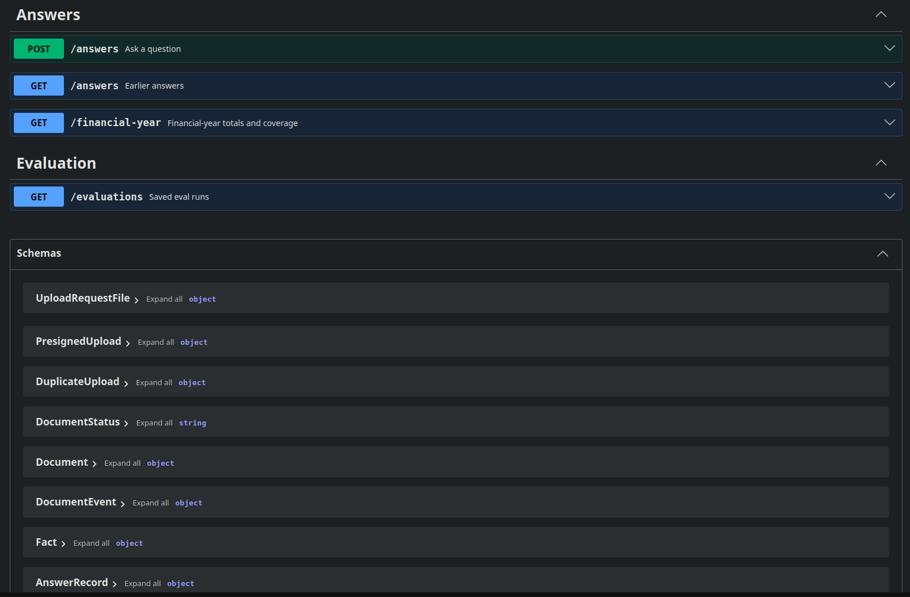

# KuKi Evidence Dashboard

## Design

Figma: [KuKi Evidence Dashboard](https://www.figma.com/design/BeooUKNEH8gXROC1TbMWEW/KuKi-Evidence-Dashboard?node-id=0-1&t=u0fQz3JjLMVKChmv-1)

## Structure

- `apps/client`: Next.js frontend
- `apps/server`: Bun + Express backend (Swagger UI at `/docs`, spec at `/openapi.yaml`)
- `apps/worker`: SQS consumer for document extraction jobs
- `apps/ai`: Python (FastAPI + OpenAI) service for extraction, evidence-based answers, financial-year totals and the eval suite. See [its README](apps/ai/README.md) for the approach, design choices and limitations
- `packages/openapi`: hand-written OpenAPI spec (`openapi.yaml`, `@kuki/openapi`)
- `packages/api`, `config`, `controllers`, `drizzle`, `handlers`, `types`, `validators`: server-side packages (`@kuki/<name>`)
- `packages/drizzle`: Postgres schema, client and migrations (`@kuki/drizzle`)
- `compose.yaml`: local Postgres
- `packages/services/aws/S3`: S3 client (`@kuki/s3`)
- `packages/services/aws/SQS`: SQS client (`@kuki/sqs`)
- `packages/services/email`: Resend client (`@kuki/email`)
- `packages/services/ai`: HTTP client for `apps/ai` (`@kuki/ai`)
- `packages/ui`: shared React components and utilities (`@kuki/ui`)
- `tests/integration`: Vitest + Supertest integration tests against the server
- `tests/e2e`: Playwright end-to-end tests against the client
- `tooling/eslint-config`: shared ESLint config (`@kuki/eslint-config`)
- `tooling/typescript-config`: shared tsconfigs (`@kuki/typescript-config`)

## API documentation

Swagger UI: [http://localhost:4000/docs](http://localhost:4000/docs). OpenAPI specification: [packages/openapi/openapi.yaml](packages/openapi/openapi.yaml).

## AWS infrastructure

### S3

### SQS

## Scripts

| Command               | Description                                             |
| --------------------- | ------------------------------------------------------- |
| `bun run dev`         | Start all apps in dev mode                              |
| `bun run build`       | Build all apps and packages                             |
| `bun run lint`        | Lint all apps and packages                              |
| `bun run check-types` | Type-check all apps and packages                        |
| `bun run test`        | Integration tests (needs `db:up`) and Python unit tests |
| `bun run db:up`       | Start the local Postgres                                |
| `bun run db:down`     | Stop the local Postgres                                 |
| `bun run db:generate` | Generate a migration from the schema                    |
| `bun run db:migrate`  | Apply migrations                                        |
| `bun run db:seed`     | Create missing databases and migrate them               |
| `bun run db:studio`   | Open Drizzle Studio                                     |
| `bun run test:e2e`    | Run Playwright end-to-end tests                         |
| `bun run format`      | Format the repo with Prettier                           |

Before the first e2e run, install the browser: `cd tests/e2e && bunx playwright install chromium`.
