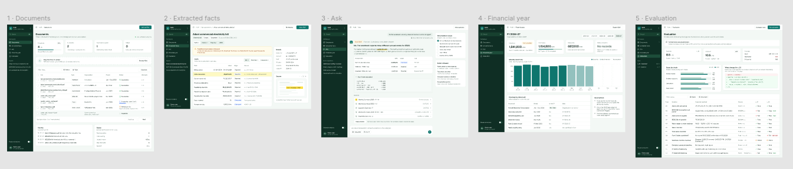
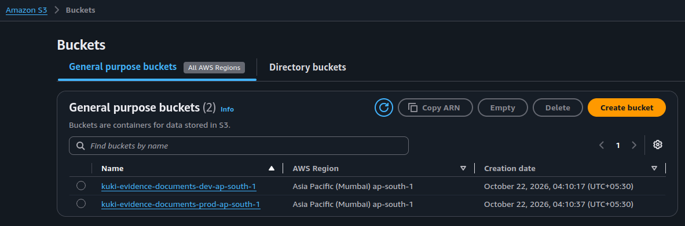
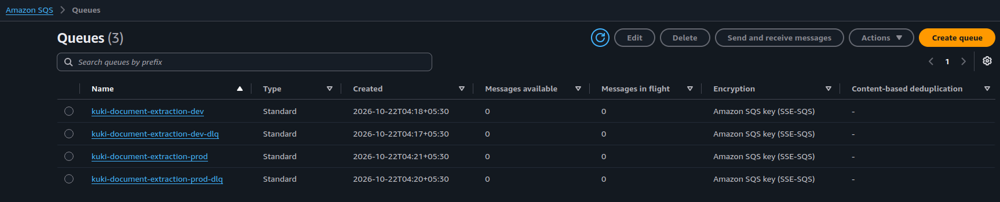

# KuKi Evidence Dashboard

## Design

Figma: [KuKi Evidence Dashboard](https://www.figma.com/design/BeooUKNEH8gXROC1TbMWEW/KuKi-Evidence-Dashboard?node-id=0-1&t=u0fQz3JjLMVKChmv-1)

[](https://www.figma.com/design/BeooUKNEH8gXROC1TbMWEW/KuKi-Evidence-Dashboard?node-id=0-1&t=u0fQz3JjLMVKChmv-1)

## Structure

- `apps/client`: Next.js frontend
- `apps/server`: Bun + Express backend (Swagger UI at `/docs`, spec at `/openapi.yaml`)
- `packages/openapi`: hand-written OpenAPI spec (`openapi.yaml`, `@kuki/openapi`)
- `packages/api`, `config`, `controllers`, `drizzle`, `handlers`, `types`, `validators`: server-side packages (`@kuki/<name>`)
- `packages/services/aws/S3`: S3 client (`@kuki/s3`)
- `packages/services/aws/SQS`: SQS client (`@kuki/sqs`)
- `packages/services/email`: Resend client (`@kuki/email`)
- `packages/ui`: shared React components and utilities (`@kuki/ui`)
- `tests/integration`: Vitest + Supertest integration tests against the server
- `tests/e2e`: Playwright end-to-end tests against the client
- `tooling/eslint-config`: shared ESLint config (`@kuki/eslint-config`)
- `tooling/typescript-config`: shared tsconfigs (`@kuki/typescript-config`)

## AWS infrastructure

### S3



### SQS



## Getting started

```sh
bun install
bun run dev
```

## Scripts

| Command               | Description                      |
| --------------------- | -------------------------------- |
| `bun run dev`         | Start all apps in dev mode       |
| `bun run build`       | Build all apps and packages      |
| `bun run lint`        | Lint all apps and packages       |
| `bun run check-types` | Type-check all apps and packages |
| `bun run test`        | Run integration tests            |
| `bun run test:e2e`    | Run Playwright end-to-end tests  |
| `bun run format`      | Format the repo with Prettier    |

Before the first e2e run, install the browser: `cd tests/e2e && bunx playwright install chromium`.
