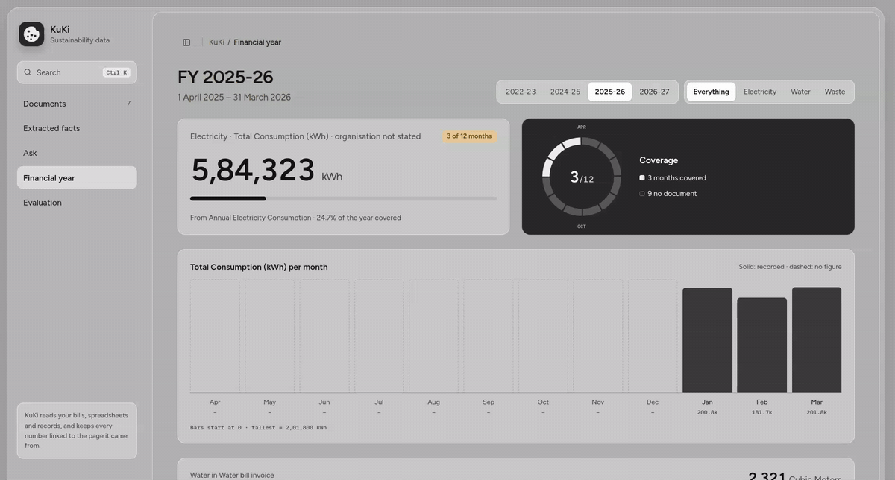
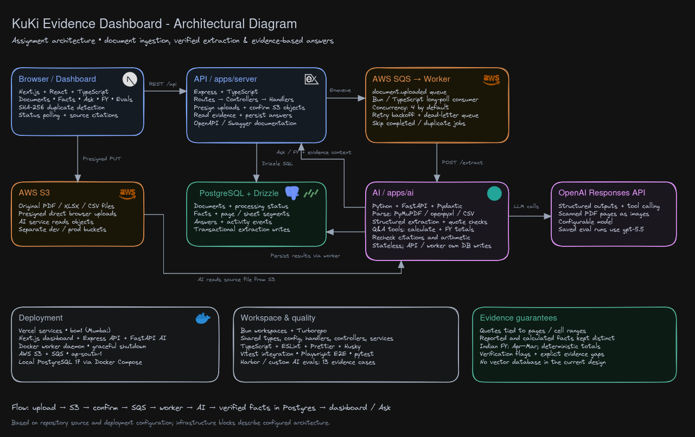
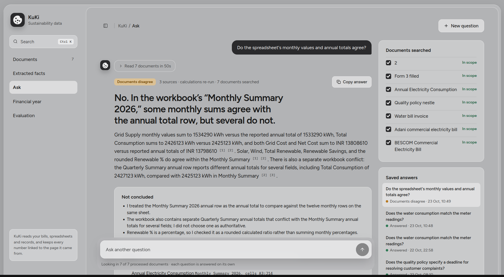
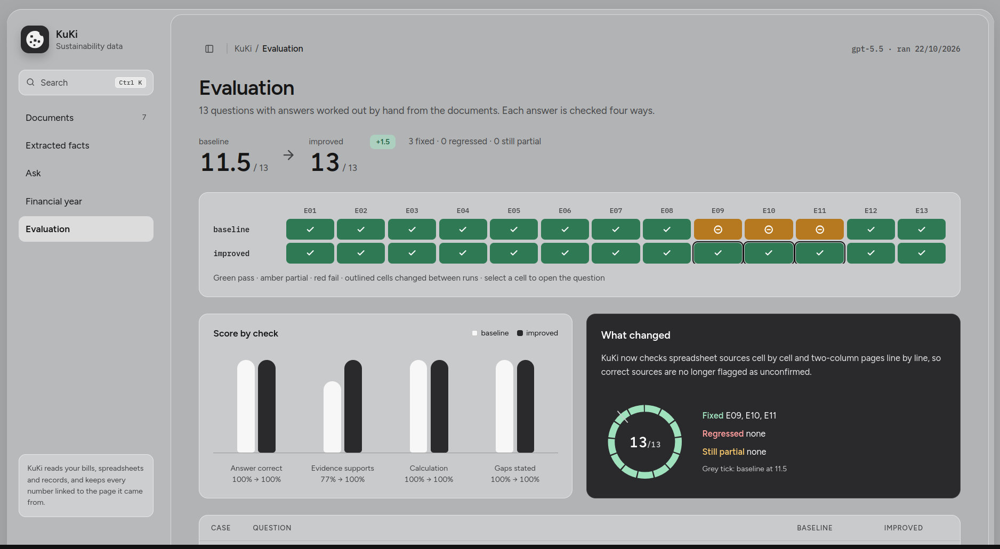
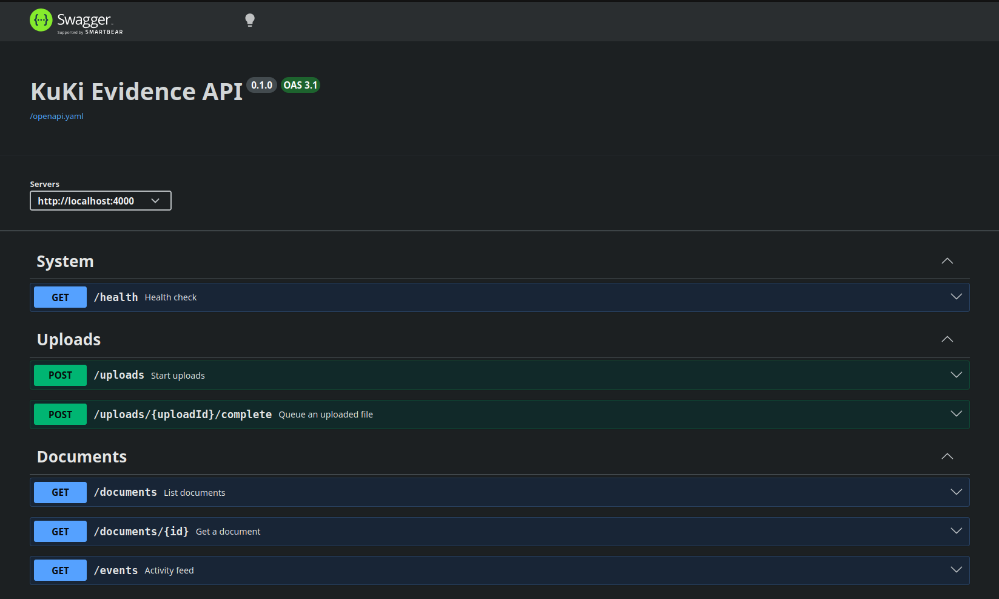

# KuKi Evidence Dashboard



**Architecture:** [View the diagram in Excalidraw](https://excalidraw.com/#json=kJGpC1FWlSz-f_mnFilPS,MNsohFFPIrbY_NnBFaH5Nw) · [Download the editable diagram](docs/architecture.excalidraw)

[](https://excalidraw.com/#json=kJGpC1FWlSz-f_mnFilPS,MNsohFFPIrbY_NnBFaH5Nw)

Upload sustainability documents (bills, spreadsheets, waste records, policies), watch them process in the background, inspect every extracted fact next to the page or cell it came from, ask questions with cited answers, and get Indian financial-year totals with their coverage.

**Try it without installing anything:** [kuki-assignment.vercel.app](https://kuki-assignment.vercel.app) (the six assignment documents are already loaded).

## Ask (`/ask`)

Ask questions across your processed documents, or select just the documents you want searched. Each answer links back to the supporting pages or spreadsheet cells, shows calculations and evidence checks, and calls out missing information or conflicting sources. Questions are answered independently, and saved answers let you revisit earlier results.

For example, asking whether a spreadsheet's monthly values agree with its annual totals identifies the mismatched sums and the separate conflict between the Monthly and Quarterly Summary sheets, rather than choosing one total as authoritative.



## Evaluations (`/evaluation`)

The Evaluation page compares saved baseline and improved runs on **13 questions with expected answers worked out by hand** from the assignment documents. Cases cover bill amounts and consumption, meter arithmetic, waste totals, conflicting workbook totals, policy gaps and financial-year coverage. Select a result cell to inspect the question and its results.

Each case is checked for **answer correctness, supporting evidence, calculation correctness and stated gaps**, where applicable. A pass earns 1 point and a partial result earns ½ point. The latest saved comparison improves from **10.5/13 (80.8%) to 13/13 (100%)**: E03, E09, E10 and E11 improve, with no case-level regressions. Evidence support rises from **10/13 to 13/13**. The improved pipeline checks spreadsheet cells and multi-column text, uses the bill's payment instructions for payment questions, and gives the model verifier feedback to repair unsupported citations before returning an answer.



These results describe the saved 13-case comparison, not a guarantee for every document. Citation ranges can still be too broad, and the suite does not cover all scanned-page or larger-document scenarios. See the [detailed results and limitations](apps/ai/README.md#eval-results-baseline--improved), [Harbor evaluation workflow](apps/ai/evals/harbor/README.md), and [local evaluation commands](#run-the-evals).

Verification includes 60 integration tests, 43 Python tests, 18 browser tests, and real SQS crash recovery, transient retries, dead-lettering and redrive. The screenshots above illustrate the workflow and can show older saved scores.

## Run it locally

You need **Docker**, **[Bun](https://bun.sh)**, **[uv](https://docs.astral.sh/uv/)**, **Node 24+**, an **OpenAI API key**, and the **[AWS CLI](https://docs.aws.amazon.com/cli/latest/userguide/getting-started-install.html)** signed in to an AWS account (`aws configure`). The setup script checks for each one and tells you how to install anything missing.

```sh
git clone https://github.com/rshdhere/kuki-assignment.git && cd kuki-assignment
OPENAI_API_KEY=sk-... bun run setup     # everything below, in one go
bun run dev                             # client :3000 · API :4000 · AI service :8000 · worker
```

Open **http://localhost:3000**, drop the six documents on the Documents page, and follow them through Extracted facts, Ask, Financial year and Evaluation. The API is documented at http://localhost:4000/docs.

`bun run setup` is safe to rerun and never overwrites an existing `.env`. It:

1. checks for the tools above;
2. installs the JavaScript and Python dependencies;
3. creates `apps/{server,worker,ai}/.env` and `apps/client/.env.local` from their examples and saves your OpenAI key;
4. creates **your own** S3 bucket and SQS queues (`scripts/setup-aws.sh`, see [Why S3 and SQS](#why-s3-and-sqs)) and writes their names into the `.env` files;
5. starts Postgres in Docker and runs the migrations;
6. unpacks `kuki-assignment-dataset.zip` into `data/documents/` if you put it in the repository root.

If the AWS CLI isn't signed in yet, setup skips step 4 and says so: run `aws configure`, then `bun run setup:aws`. The bucket is private (`kuki-documents-<account-id>-<region>`), and the region defaults to `ap-south-1` (override with `AWS_REGION=...`).

### Run the evals

With the documents in `data/documents/`:

```sh
cd apps/ai
uv run kuki-eval run --pipeline baseline
uv run kuki-eval run --pipeline improved
uv run kuki-eval compare baseline improved    # writes evals/results/comparison.md
```

The 13 cases, the scoring, the saved baseline and improved runs, the weakness that was fixed and the known limitations are in [apps/ai/README.md](apps/ai/README.md#evals). The dashboard's Evaluation page shows the same results.

### If something doesn't work

| Symptom                                      | Fix                                                                                                  |
| -------------------------------------------- | ---------------------------------------------------------------------------------------------------- |
| Uploads fail straight away in the browser    | The bucket's CORS must allow `http://localhost:3000`. Rerun `bun run setup:aws`.                     |
| Documents stay on "Waiting to be read"       | The worker isn't running or has no queue. Check `AWS_SQS_QUEUE_URL` in `apps/worker/.env`.           |
| Documents fail with an OpenAI error          | Check `OPENAI_API_KEY` (and `OPENAI_MODEL`) in `apps/ai/.env`.                                       |
| `db:seed` can't connect                      | Start Docker, then `bun run db:up`. Postgres listens on `localhost:5432` (user and password `kuki`). |
| Port 3000, 4000, 5432 or 8000 already in use | Stop whatever is using it; the apps expect these ports.                                              |

## API documentation

[Swagger UI](https://kuki-assignment.vercel.app/docs/)

[](https://kuki-assignment.vercel.app/docs/)

## Architecture

[](https://excalidraw.com/#json=kJGpC1FWlSz-f_mnFilPS,MNsohFFPIrbY_NnBFaH5Nw)

Upload → S3 → confirm → SQS → worker → AI service → verified facts in Postgres → dashboard and Ask. Click the diagram to open the editable version ([source](docs/architecture.excalidraw)).

## Why S3 and SQS

**S3 holds the original files.** The API never handles file bytes: it hands the browser a presigned PUT and the file goes straight to S3. That keeps uploads off the serverless API, whose request bodies are capped at a few megabytes on Vercel, while a scanned PDF can be far larger. Each presigned URL signs the file's size, type and SHA-256, so S3 itself rejects an upload that doesn't match what was approved. Files are stored with eleven nines of durability, encrypted at rest and private, and they stay the source of truth: any document can be re-extracted later with a better model without asking anyone to upload it again.

**SQS turns "process this document" into a job that can't get lost.** The worker long-polls the queue; a job that crashes or times out simply reappears after the visibility timeout and is retried with backoff. After 10 failed receives it moves to a dead-letter queue to be inspected and redriven, instead of retrying forever. Jobs survive restarts of every app, there is no queue server to run or patch, and many workers can consume the same queue.

**And both cost almost nothing.** Prices are for `ap-south-1` at the time of writing; see [S3 pricing](https://aws.amazon.com/s3/pricing/) and [SQS pricing](https://aws.amazon.com/sqs/pricing/).

| What                 | Price                                                                    | KuKi's usage                                                                                                                                           | Monthly cost                    |
| -------------------- | ------------------------------------------------------------------------ | ------------------------------------------------------------------------------------------------------------------------------------------------------ | ------------------------------- |
| SQS requests         | First **1 million free every month** (no expiry), then $0.40 per million | An idle worker long-polls 3 times a minute (20-second waits), about 130,000 requests a month. Each document adds about 3 more (send, receive, delete). | **$0** until ~290,000 documents |
| S3 storage           | about $0.025 per GB-month                                                | The six assignment documents are 3.8 MB. 1,000 typical documents are about 1 GB.                                                                       | about **$0.03** per 1,000 docs  |
| S3 uploads and reads | about $0.005 per 1,000 PUTs, $0.0004 per 1,000 GETs                      | One PUT per upload, one GET per extraction.                                                                                                            | under **$0.01** per 1,000 docs  |

Even the smallest server for a self-hosted queue (Redis, RabbitMQ) would cost more each month, and we would still have to build and operate retries, a dead-letter queue and persistence ourselves. Duplicate uploads cost nothing either: files are matched by SHA-256 before upload, so a file already in KuKi is never stored or processed twice.

### S3


### SQS


## Worker deployment

The worker Dockerfile lives in `docker/Dockerfile.worker`. Vercel uses the
Dockerfile directory as its build context, so CI runs
`bash scripts/prepare-worker-build.sh` before deployment to stage a copy at the
repository root. Run the same command before a manual Vercel deployment.

Production CI uses the protected production environment secret
`PRODUCTION_DATABASE_URL` to apply pending database migrations before deploying.
Vercel's sensitive values cannot be recovered through an environment pull.
CI then checks the live documents, extracted facts
and evaluation endpoints; a passing `/health` alone does not count as a working
deployment. For a manual deployment, apply migrations first with
`bun --env-file=.env.production.local packages/drizzle/src/deploy.ts`.

## Scripts

| Command               | Description                                                  |
| --------------------- | ------------------------------------------------------------ |
| `bun run setup`       | One-time local setup (see [Run it locally](#run-it-locally)) |
| `bun run setup:aws`   | Create your S3 bucket and SQS queues and wire them up        |
| `bun run dev`         | Start all apps in dev mode                                   |
| `bun run build`       | Build all apps and packages                                  |
| `bun run lint`        | Lint all apps and packages                                   |
| `bun run check-types` | Type-check all apps and packages                             |
| `bun run test`        | Integration tests (needs `db:up`) and Python unit tests      |
| `bun run db:up`       | Start the local Postgres                                     |
| `bun run db:down`     | Stop the local Postgres                                      |
| `bun run db:generate` | Generate a migration from the schema                         |
| `bun run db:migrate`  | Apply migrations                                             |
| `bun run db:seed`     | Create missing databases and migrate them                    |
| `bun run db:studio`   | Open Drizzle Studio                                          |
| `bun run test:e2e`    | Run Playwright end-to-end tests                              |
| `bun run format`      | Format the repo with Prettier                                |

Before the first e2e run, install the browser: `cd tests/e2e && bunx playwright install chromium`.

## Design

Figma: [KuKi Evidence Dashboard](https://www.figma.com/design/mGmLPlKGNmLxhDSSjATCYs/KuKi-%E2%80%94-Dashboard?node-id=0-1&t=3zGa5UCzS8nvLtiX-1)

[](https://www.figma.com/design/mGmLPlKGNmLxhDSSjATCYs/KuKi-%E2%80%94-Dashboard?node-id=0-1&t=3zGa5UCzS8nvLtiX-1)
