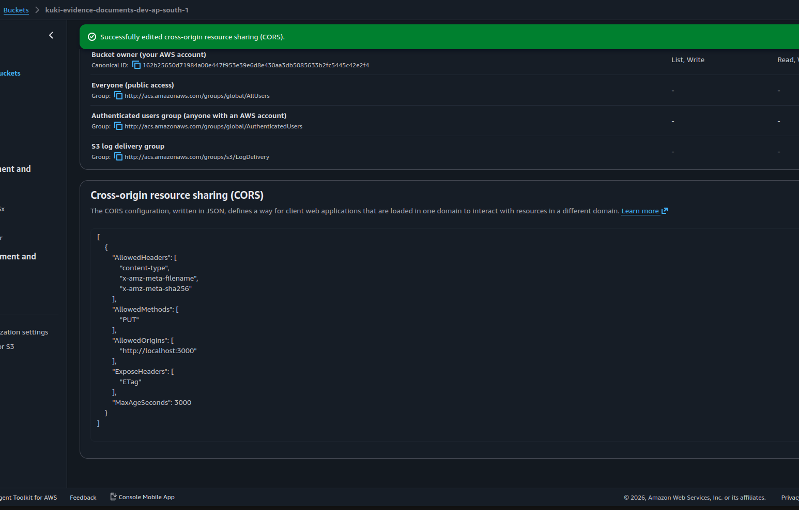

# S3

`@kuki/s3`: [Amazon S3](https://aws.amazon.com/s3/) client for file storage.

## AWS resources

Buckets live in **Asia Pacific (Mumbai) `ap-south-1`**, one per environment.

| Environment | Bucket                                    |
| ----------- | ----------------------------------------- |
| Dev         | `kuki-evidence-documents-dev-ap-south-1`  |
| Prod        | `kuki-evidence-documents-prod-ap-south-1` |

Split objects by prefix inside a bucket (e.g. `uploads/`, `extracted/`) rather than creating more buckets.


## Usage

```ts
import { PutObjectCommand } from "@aws-sdk/client-s3";
import { s3 } from "@kuki/s3";

await s3.send(
  new PutObjectCommand({
    Bucket: "kuki-evidence-documents-dev-ap-south-1",
    Key: "file.pdf",
    Body: buffer,
  }),
);
```

## Uploads

Browsers upload straight to S3 with presigned PUTs (see the upload pipeline in the root README):

- `presignPut(...)`: presigns a PUT. Content type, length and `x-amz-meta-*` metadata are signed headers, so S3 rejects an upload whose body size, type or metadata differ from what was presigned.
- `headObject(bucket, key)`: size, type and metadata of an object, or `null` if it doesn't exist.

The client sets `requestChecksumCalculation: "WHEN_REQUIRED"`. With the SDK default, presigned PUT URLs include a CRC32 of an empty body and every real upload fails.

### Bucket CORS

Each bucket needs a CORS rule so the browser can PUT to it (**Permissions → Cross-origin resource sharing**). Without it, the browser's preflight gets a 403 and every upload fails.

| Bucket | CORS                                                       |
| ------ | ---------------------------------------------------------- |
| Dev    | Configured for `http://localhost:3000`                     |
| Prod   | **Not configured yet**: add the client's production origin |

The dev rule (use the client's origin(s) for each environment):

```json
[
  {
    "AllowedOrigins": ["http://localhost:3000"],
    "AllowedMethods": ["PUT"],
    "AllowedHeaders": [
      "content-type",
      "x-amz-meta-filename",
      "x-amz-meta-sha256"
    ],
    "ExposeHeaders": ["ETag"],
    "MaxAgeSeconds": 3000
  }
]
```



### IAM

The server's identity signs the URLs, so it needs `s3:PutObject` and `s3:GetObject` on `uploads/*`, plus `s3:ListBucket` on the bucket. Without `ListBucket`, `HeadObject` on a missing key returns 403 instead of 404, and `POST /uploads/:id/complete` responds 500 instead of 404.

In dev, one IAM user covers both the server and the worker. In prod, give each its own IAM role (see `apps/worker/README.md` for the worker's permissions) instead of access keys.

## Files

- `src/client.ts`: the shared `S3Client` instance
- `src/uploads.ts`: presigned PUTs and `headObject`
- `src/index.ts`: public exports

Put S3 helpers (uploads, presigned URLs, etc.) in their own files under `src/` and re-export them from `src/index.ts`.

## Environment

| Variable        | Description                                                         |
| --------------- | ------------------------------------------------------------------- |
| `AWS_REGION`    | Region the client connects to                                       |
| `AWS_S3_BUCKET` | Bucket for uploads (via `@kuki/config`, defaults to the dev bucket) |

Credentials come from the default AWS provider chain: `AWS_ACCESS_KEY_ID` / `AWS_SECRET_ACCESS_KEY` env vars, a shared profile, or an IAM role.

## Scripts

```sh
bun run lint         # ESLint
bun run check-types  # tsc --noEmit
```
